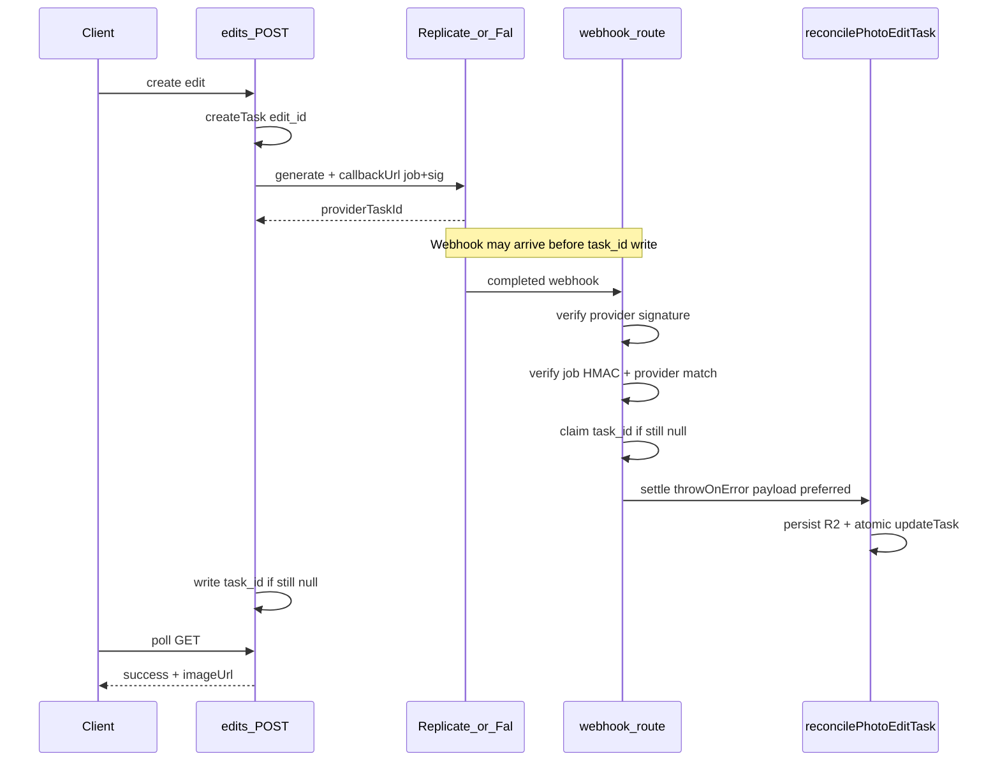

# Photo-edit Webhook 接入方案

> 状态：已在分支 `feat/photo-edit-webhook-20261109` 实现；`pnpm test:photo-edit` 通过。
> 解决「供应商已成功、浏览器未轮询 → 结果被清理 → Admin 显示 Failed」的问题。

## 问题

供应商（Replicate / Fal）约 11 秒即可完成编辑，但结果目前主要靠浏览器轮询落库。用户关页或轮询中断后，等到对账时 Replicate 侧常已 `data_removed`，本库被标成 `failed` 并退积分，图无法找回。

两边 provider 的 `generate` **已支持** `callbackUrl`，只是提交路由没传。另外现有 reconcile / 退款路径还有若干 Webhook 场景下的缺口（见下方 P0/P1）。

## 目标

- Webhook 主动接收完成事件并持久化结果到 R2。
- 前端轮询只负责实时 UI，并保留兜底结算能力。
- Cron 继续处理遗漏 / 僵死任务。
- 不丢图、不重复扣费、不错退积分。
- 最小改动：不引入 Redis / 队列；优先不改 schema。

## 方案总览



## P0 / P1 决策

### P0：Webhook 异常不能被吞掉

`reconcilePhotoEditTask` 增加 `throwOnError?: boolean`（默认 `false`，不破坏轮询 / list / cron）：

| 场景                            | 轮询 (`throwOnError=false`) | Webhook (`throwOnError=true`) |
| ------------------------------- | --------------------------- | ----------------------------- |
| 供应商查询临时失败              | 返回 pending，继续轮询      | **抛错 → 5xx**，供应商重试    |
| R2 持久化失败                   | 返回 pending（未过期）      | **抛错 → 5xx**                |
| 供应商 FAILED / 成功无图 / 过期 | `markFailed` + 退款 → 终态  | 同左，**返回 200**（勿重试）  |
| 已终态                          | 原样返回                    | **200 幂等**                  |

### P0：生产必须落到 R2

`persistPhotoOutput`：无 Storage 时，仅非 production 允许回退供应商 URL；production（含 Workers）**抛错**，禁止把临时 URL 写成 success。

R2 object key 改为确定性 `photo-editor/{taskId}.png`，并发结算覆盖同一 key，减少孤儿文件。

### P1：Webhook 早于 `task_id` 落库

不改 schema。callbackUrl 带本库任务 id：

```text
{app_url}/api/photo-editor/webhook/{provider}?job={edit_id}&sig={hmac}
```

- `sig = HMAC-SHA256(AUTH_SECRET, "{provider}:{job}")`（与 upload-token 同风格）。
- 任务在 `generate` **之前**已 `createTask`，故按 `job` 总能查到行。
- 验签通过后：若 `task_id` 为空，用 payload 的 provider id **认领写入**（guard：仅当仍为 null）；若已有且不一致 → 拒绝。
- 同时校验 `task.provider === path provider`、`id` 以 `edit_` 开头。
- **禁止**「找不到任务就无条件 200」。HMAC 无效 → 401；任务不存在（极端）→ 503 以便重试。

### P1：失败退款可靠

`updateTask(FAILED)` 把状态更新与 `revoke` 步骤放进**同一次** `atomic()`（抽取 `planRevoke`）。失败则整笔回滚，Webhook 可 5xx 重试。

补偿：`ensurePhotoEditRefund(task)` — 对已 `failed`/`canceled` 但 consume 仍 `active` 的行再调幂等 `revoke`（覆盖历史中断 / 旧代码路径）。reconcile / webhook / cron 结算后调用。

### P1：并发结算

复用 `updateTask` 的 pending/processing guard：终态只写一次；迟到的 failed 无法覆盖 success；退款 claim guard 保证只退一次。确定性 R2 key 避免双写两份对象。

### Webhook payload 优先

验签后若 payload 已含可解析图片 URL，构造 `AITaskResult` 传给 reconcile 的 `remote` 覆盖，**少打一次**供应商 query；缺结果时再 query。

## 实现清单

| 文件                                               | 改动                                          |
| -------------------------------------------------- | --------------------------------------------- |
| `src/routes/api/photo-editor/edits.ts`             | `callbackUrl` 带 job+sig                      |
| `src/core/ai/fal.ts`                               | `encodeURIComponent(callbackUrl)`             |
| `src/modules/photo-editor/service.ts`              | 生产强制 R2；确定性 key                       |
| `src/modules/photo-editor/reconcile.ts`            | `throwOnError`、`remote`、结算后 ensureRefund |
| `src/modules/photo-editor/webhook.ts`              | 验签、认领 task_id、settle                    |
| `src/modules/photo-editor/webhook-sign.ts`         | job HMAC 签发/校验                            |
| `src/routes/api/photo-editor/webhook/$provider.ts` | POST 入口                                     |
| `src/modules/credits/service.ts`                   | `planRevoke`                                  |
| `src/modules/ai-tasks/service.ts`                  | FAILED 与 revoke 同 atomic；ensureRefund      |
| `tests/photo-edit-webhook.test.ts`                 | 见下                                          |
| `docs/photo-edit-webhook-plan.md` / `UPGRADING.md` | 本文 + 升级说明                               |
| `package.json`                                     | `test:photo-edit` 纳入 webhook 测试           |

## 验签细节

- **Replicate**：Standard Webhooks；`GET /v1/webhooks/default/secret`（用现有 `replicate_api_token`）内存缓存；校验 `webhook-id` / `webhook-timestamp` / `webhook-signature`；±5 分钟。
- **Fal**：`X-Fal-Webhook-*` ED25519；JWKS `https://rest.fal.ai/.well-known/jwks.json` 缓存 ≤24h；±5 分钟。
- localhost / 非 http(s) 的 `app_url`：不传 callback（与现 provider 过滤一致），仍靠轮询 + cron。

## 测试矩阵

- 非法签名 → 401
- 合法回调 → success + R2（mock persist）
- 重复 Webhook → 幂等 200
- R2 失败 → 5xx，任务仍 pending，可重试成功
- Webhook 早于 `task_id` 落库 → 认领并结算
- Webhook 与轮询并发 → 仅一次 success / 一次扣费
- 供应商失败 → failed + 退款
- 退款中断恢复 → `ensurePhotoEditRefund` 补退
- 已成功 + 迟到 failed → 保持 success
- 成功但无图 → failed + 退款 + 200
- Cron 仍能结算遗漏任务（现有 reconcile 测试保留）

脚本：`pnpm test:photo-edit`（含 reconcile / credits / webhook）。无顶层 `pnpm test`。

## Cron 现状

生产 `wrangler.jsonc` **未配置** Cloudflare Cron Triggers；`CRON_SECRET` 与 `/api/cron/reconcile-photo-edits` 已存在。部署后应在 Workers 配触发器，或用外部 cron 带 Bearer 调用。Webhook 上线后 cron 仍是兜底，不是主路径。

## 不改

- 积分价格、前端 UI、供应商选择策略
- schema / 新基础设施
- 管理后台 Failed 明细展示（另议）

## 验收

1. 生产提交后立刻关页，约数十秒内任务 `success` 且结果在自有 R2 域名。
2. 伪造签名 → 401。
3. 同 `task_id` 重复投递不二次扣/退。
4. `pnpm test:photo-edit` 通过。
