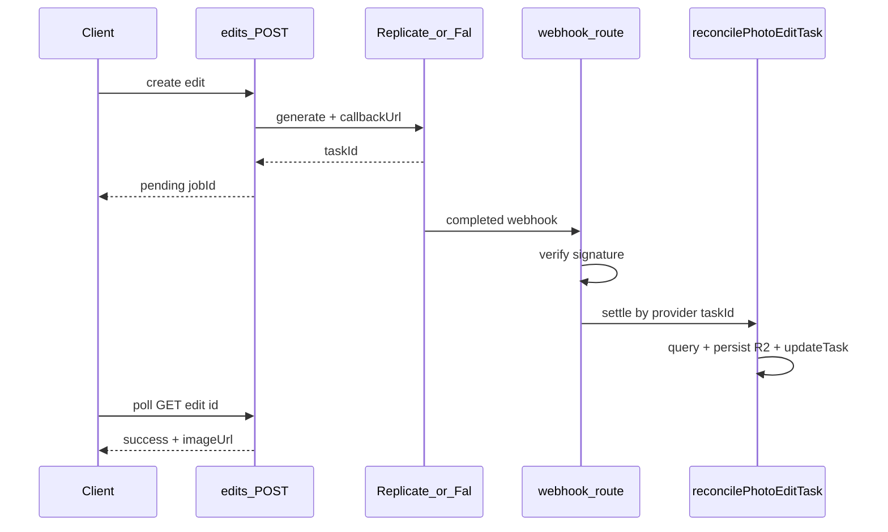

# Photo-edit Webhook 接入方案

> 状态：待实现。解决「供应商已成功、浏览器未轮询 → 结果被清理 → Admin 显示 Failed」的问题。

## 问题

供应商（Replicate / Fal）约 11 秒即可完成编辑，但结果目前只靠浏览器轮询落库。用户关页或轮询中断后，等到对账时 Replicate 侧常已 `data_removed`，本库被标成 `failed` 并退积分，图无法找回。

两边 provider 的 `generate` **已支持** `callbackUrl`（见 `src/core/ai/replicate.ts`、`src/core/ai/fal.ts`），只是 `src/routes/api/photo-editor/edits.ts` 提交时没传。

## 方案



**默认决策：** 验签后不直接信任 payload 里的图片 URL，统一走现有 `reconcilePhotoEditTask` 再向供应商 query 一次，再 `persistPhotoOutput`。幂等、退积分、缺图失败逻辑全复用。前端轮询与 cron reconcile 保留作兜底；localhost 仍不传 webhook（provider 已过滤）。

## 实现步骤

### 1. 提交时挂回调

在 `src/routes/api/photo-editor/edits.ts` 的 `instance.generate` 传入：

```ts
callbackUrl: `${envConfigs.app_url}/api/photo-editor/webhook/${provider}`;
```

生产 `VITE_APP_URL=https://getaiphotoeditor.com` 已满足 Replicate/Fal 的非 localhost 校验。

顺手修 `src/core/ai/fal.ts` 里 `fal_webhook=` 未 `encodeURIComponent` 的问题。

### 2. Webhook 路由 + 验签结算

新增：

- `src/routes/api/photo-editor/webhook/$provider.ts` — `POST`，`provider` ∈ `replicate` | `fal`
- `src/modules/photo-editor/webhook.ts` — 验签与结算

验签：

- **Replicate**：Standard Webhooks（`webhook-id` / `webhook-timestamp` / `webhook-signature`），密钥用现有 `replicate_api_token` 调 `GET https://api.replicate.com/v1/webhooks/default/secret` 拉取缓存（内存 TTL）
- **Fal**：`X-Fal-Webhook-*` ED25519，对照 `https://rest.fal.ai/.well-known/jwks.json`（缓存 ≤24h）
- 时间窗 ±5 分钟，拒绝重放

结算：

1. 从 payload 取 provider id（Replicate `id` / Fal `request_id`）
2. `findPhotoEditByProviderTaskId`（`ai_task.task_id` + `id like edit_%`）
3. 找不到或已终态 → `200`（ack，避免重试风暴）
4. 否则 `reconcilePhotoEditTask(task)`；持久化失败返回 `5xx` 让供应商重试

### 3. 查询辅助

在 `src/modules/photo-editor/`（或 `ai-tasks/service`）增加按 provider `taskId` 查 photo-edit 行的函数；不改 schema。

### 4. 测试与升级说明

- 新增 `tests/photo-edit-webhook.test.ts`：验签失败 401、合法签名触发 settle、已终态幂等 200
- `UPGRADING.md` 记一条：新公开回调 `/api/photo-editor/webhook/{replicate|fal}`，要求 `VITE_APP_URL` 为公网 HTTPS；无 schema/权限变更

## 不改

- 前端轮询逻辑（仍用于实时 UI）
- cron reconcile（兜底）
- 管理后台 Failed 展示（另议）

## 验收

1. 生产提交一次 edit 后立刻关页，约 15 秒内任务应变为 `success` 且 R2 有结果图
2. 伪造 webhook（无签名）返回 401，任务状态不变
3. 同一 `task_id` 重复投递不二次扣/退积分
4. 现有 `pnpm test` 中 photo-edit reconcile / credits 用例仍通过
