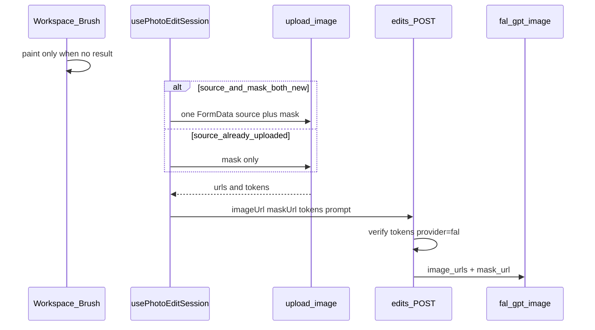

# 整站迁 Fal + 首页精准编辑（Mask）

> 状态：已落地；`pnpm test:photo-edit` + `tsc` 通过。
> 目标：新建照片编辑统一走 Fal；首页支持精准涂抹，生成时把 mask 以 Fal `mask_url` 交给供应商。

## 现状

- 编辑供应商由 admin `photo_editor_provider` 决定，**默认 `replicate`**；仅 `remove-background` 强制 fal。
- 首页 / enhance 等均走 `src/routes/api/photo-editor/edits.ts` → `getSelectedPhotoProvider`。
- Fal `openai/gpt-image-2.6/flare/edit` 支持 `mask_url`（白=编辑区，黑=保留）；Replicate 公开 schema 无 mask。
- OpenAI 官方 Images Edit 支持 mask；本站经 Fal/Replicate 封装，能稳定带 mask 的是 Fal。
- 首页尚无笔刷 UI；生成 POST 无 mask 字段。

## 决策

### A. 整站迁 Fal

1. **新建照片编辑任务一律用 fal**（含 homepage `general`、enhance、以及其它非抠图 tool）。
2. `getSelectedPhotoProvider` 改为**始终返回 `'fal'`**（不再读 DB 选择 replicate）。
3. Admin：`photo_editor_provider` defaultValue 改为 `fal`；setting 可保留，tip 写明编辑已固定 fal（避免大范围 admin UI 重构）。
4. **不删** `ReplicateProvider`、replicate webhook 验签与 reconcile 分支：用于结算迁移前已提交、仍 pending 的旧任务。
5. 不删 `replicate_api_token` admin 配置（历史任务 / 设置页 Test 仍可能用到）。
6. `UPGRADING.md` 记一条：编辑现固定 fal，请配置 `fal_api_key`；旧 replicate 任务仍可由 webhook/poll 结清。

### B. 首页精准编辑

1. **仅首页** `PhotoEditorWorkspace`；不去改 background remover / enhancer 的笔刷 UI。
2. Mask：与原图同尺寸 PNG；**白=可改、黑=保留**（Fal `mask_url`）；UI 半透明叠层，提交前栅格化。
3. 开启但未涂抹 → 不传 mask。
4. 关开关 / 换图 / Edit Again → 清空笔刷历史。

### C. Review P1（定死）

1. **原图 + mask 合并上传，避开 1s 限流**
   - `/api/storage/upload-image` 对 IP/账号有 **1s** `enforceMinIntervalRateLimit`。若先传原图再立刻传 mask，第二次会被限流，精准编辑提交失败。
   - **首次**两者都未上传：同一 `FormData` 一次 `files` 带上原图 + mask，单次请求拿回两条 `url`/`token`（按返回顺序或明确字段区分：`results[0]` 原图、`results[1]` mask）。
   - 原图已有 `upload`（或 `sourceJobId` 复用历史结果）：**只上传 mask**。
   - 实现时在 `use-photo-edit-session` 提交路径写清分支，禁止「有 mask 时无条件再打一次 upload」。

2. **有 `result` 时禁止涂抹，避免画在结果图上却按输入图交 mask**
   - 成功后默认展示 `result`，`preview` 仍在；若仍开笔刷，用户会以为在画结果，提交却相对输入图，canvas / 预览 / 提交源不一致。
   - **定死**：存在 `result`（未点 Edit Again）时：**隐藏或禁用** Precision Switch 与笔刷；仅 `Edit Again` 清掉 `result`、输入切到新底图后再允许精准编辑。
   - 不采用「开精准编辑时自动切回 Original」——易误触改结果视图；统一要求先 Edit Again。
   - Canvas 尺寸、预览底图、提交 `imageUrl` 必须始终同一张输入图。

## 数据流

## 实现要点

### 供应商迁移

| 文件                                   | 改动                                                                                       |
| -------------------------------------- | ------------------------------------------------------------------------------------------ |
| `src/modules/photo-editor/service.ts`  | `getSelectedPhotoProvider` → 恒 `'fal'`；`photoModelInput` 可选 `maskUrl` → fal `mask_url` |
| `src/routes/api/photo-editor/edits.ts` | 解析可选 `maskUrl` / `maskUploadToken` 并 `verifyUploadToken`；`options` 可存 `maskUrl`    |
| `src/modules/config/settings.ts`       | `photo_editor_provider` default `fal`，tip 注明已固定 fal                                  |
| `UPGRADING.md`                         | 迁移说明                                                                                   |
| `tests/*`                              | 默认 provider 断言改为 fal；保留历史 replicate webhook/reconcile 用例                      |

### UI（Workspace 右上角）

- **仅** `preview` 存在、无 `result`、非 loading：右侧 **Precision edit** Switch。
- 开启后：笔刷大小（约 8–80px）、Undo、Redo；笔刷叠在**当前输入图**上。
- 有 `result`：不展示 Switch / 笔刷工具（须 Edit Again 后才能再涂）。
- 新建 `src/components/photo-editor/mask-brush-canvas.tsx`（+ 可选 `use-mask-brush.ts`）：object-contain 对齐、stroke 栈 undo/redo、`exportMaskBlob()`。
- 文案可与现有 workspace 一样先硬编码英文。

### 客户端提交

`use-photo-edit-session.ts`：

- 可选 `getMaskFile`。
- 上传分支（P1）：
  - `file && !upload` 且有 mask → **一次** FormData：`files` = [原图, mask]。
  - 已有 `upload` / `sourceJobId` 且有 mask → 只传 mask。
  - 无 mask → 保持现有单文件上传。
- POST 增加 `maskUrl` / `maskUploadToken`；笔刷变化时清空 `requestId`。

## 测试

- `photoModelInput('fal', …, mask)` 含 `mask_url`。
- `getSelectedPhotoProvider()` 恒为 `fal`。
- 可选：mask 无 token → 403。

## 不改

- Schema、积分表。
- 删除 Replicate 核心适配器 / 历史 webhook（本轮不拆除）。
- 抠图以外页面的笔刷 UI。

## 价格背景（选型依据）

- Fal：与 OpenAI 同 token 价，成本随 quality / 尺寸 / 参考图变化。
- Replicate：按张 × quality 一口价，high 及以上通常更贵，且无 mask 字段。
- 站内积分表按 Fal/官方 1024 估价制定，与整站迁 Fal 对齐。
